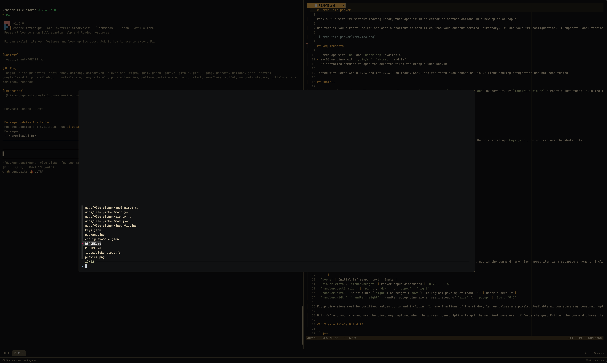

# Herdr File Picker

**Your fzf, one keystroke away. You decide what every key does.**

Press <kbd>Cmd</kbd>+<kbd>O</kbd> in Herdr and fzf opens over the terminal you're working in. Find a file, then press a key to act on it. You choose the actions: any command, on any fzf key, opening in a split or popup next to your work.



- **Your fzf, untouched.** `FZF_DEFAULT_COMMAND`, previews, colors, and keybindings all carry over.
- **One key per action.** Map any fzf key to any command: editors, pagers, git, diff viewers.
- **Opens where you want.** A right split, a lower split, or a floating popup, sized your way.
- **Cleans up after itself.** When the command exits, its split or popup closes.

## Install

Ask your Herdr agent:

> Add the mod from github.com/arjunmahishi/herdr-file-picker

<details>
<summary>Or install it by hand</summary>

From a clone of this repo:

```sh
herdr_home="${HERDR_APP_HOME:-$HOME/.config/herdr-app}"
mkdir -p "$herdr_home/mods"
ln -s "$PWD/mods/file-picker" "$herdr_home/mods/file-picker"
cp -i config.example.json "$herdr_home/file-picker.json"
```

Then merge this binding into your existing `keys.json`:

```json
{ "global": { "cmd-o": "mod.open:file-picker" } }
```

</details>

**Needs:** Herdr App and [fzf](https://github.com/junegunn/fzf). Tested on macOS with Herdr App 0.1.13 and fzf 0.43.0.

## Configure

Settings live in `file-picker.json` in your Herdr home. The file is read every time the picker opens, so edits take effect right away. Here's a two-key starter:

```json
{
  "actions": {
    "enter":  { "argv": ["nvim", "--", "{file}"], "label": "edit" },
    "ctrl-d": { "argv": ["git", "diff", "--", "{file}"], "label": "diff", "destination": "popup" }
  }
}
```

Each key under `actions` is an fzf key name (`enter`, `ctrl-d`, `alt-x`, `f2`, …), and you must define `enter`. `argv` is the command to run. `{file}` is replaced with the path you picked. A header above the list shows each key's label.

<details>
<summary>All settings</summary>

| Setting | What it does | Default |
| --- | --- | --- |
| `query` | Initial search text | `""` |
| `header` | Show the key/label header | `true` |
| `picker.width`, `picker.height` | Picker size | `0.75`, `0.65` |
| `actions.<key>.argv` | Command to run; `{file}` goes in an argument, not the command name | required |
| `actions.<key>.label` | Name shown in the header | the command name |
| `actions.<key>.destination` | `right`, `down`, or `popup` | `right` |
| `actions.<key>.size` | Split width or height, in pixels | Herdr's default |
| `actions.<key>.width`, `.height` | Popup size | `0.6`, `0.5` |

Sizes up to `1` are fractions of the window. Larger values are pixels.

</details>

## Recipes

Paste any of these under `actions`, and swap the key if you like.

<details>
<summary><b>Edit in a big floating Neovim</b></summary>

```json
"enter": {
  "argv": ["nvim", "--", "{file}"],
  "label": "edit",
  "destination": "popup", "width": 0.9, "height": 0.85
}
```

</details>

<details>
<summary><b>Peek at a file</b> without opening an editor</summary>

```json
"ctrl-v": {
  "argv": ["less", "--", "{file}"],
  "label": "peek",
  "destination": "right", "size": 700
}
```

Press <kbd>q</kbd> to close it.

</details>

<details>
<summary><b>See what changed</b> in a file</summary>

```json
"ctrl-d": {
  "argv": ["sh", "-c", "git diff --color=always -- \"$1\" | less -R", "diff", "{file}"],
  "label": "diff",
  "destination": "popup", "width": 0.8, "height": 0.8
}
```

To use a shell pipeline, pass `{file}` as its own argument (`"$1"`), never inside the script text.

</details>

<details>
<summary><b>Review changes in <a href="https://github.com/modem-dev/hunk">Hunk</a></b></summary>

```json
"alt-d": {
  "argv": ["hunk", "diff", "--", "{file}"],
  "label": "review",
  "destination": "popup", "width": 0.95, "height": 0.9
}
```

For staged changes, use `["hunk", "diff", "--staged", "--", "{file}"]`.

</details>

<details>
<summary><b>Dig through a file's history</b></summary>

```json
"ctrl-l": {
  "argv": ["git", "log", "--follow", "-p", "--", "{file}"],
  "label": "history",
  "destination": "popup", "width": 0.9, "height": 0.85
}
```

</details>

## Good to know

- Works in local terminals, one file at a time.
- Action keys take over fzf's own bindings for the same key. Avoid plain letters, or you won't be able to type them in the search.
- Don't put `--expect`, `--print-query`, or `--multi` in `FZF_DEFAULT_OPTS`. The picker needs fzf's normal output.
- Pagers that quit on short output (such as `less -F`) close their split right away.
