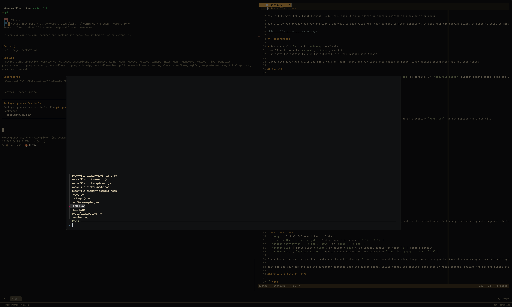

# Herdr file picker

A centered terminal-backed fzf popup over the current Herdr workspace. Selecting a file runs a configurable command in a separate split or popup; exiting that command removes its surface.

## What you see

A small “Opening fzf…” controller sits behind the picker while it runs. The centered picker defaults to 75% of the window width and 65% of its height. It is a native Herdr terminal, with the user's fonts, colors, and fzf appearance. Handler popups default to 60% width and 50% height. Failed launches produce Herdr error notifications.

## How it behaves

Open via `mod.open:file-picker`. Capture the focused local terminal's directory and source pane. Run native fzf, honoring its environment, with the configured initial query. Escape cancels without a handler. Selection closes the picker, substitutes the path into the configured command argument array, and starts it in the captured directory. Target the original source pane for splits. A handler's exit closes its split or popup. External popup closure kills its terminal. The mod does not inspect or style agent status.

## Built from

- `mods/file-picker/main.js`: GPUI View controller, terminal-overlay layouts, cleanup-only child View, configuration loading, notifications, and Herdr command orchestration.
- `mods/file-picker/picker.js`: config validation, selection parsing, and POSIX command argument builders. `/bin/sh` redirects fzf's NUL-delimited output to a private `mktemp` file and executes the handler with positional arguments. No Python or Node runtime is needed.
- `mod.json`: overlay entry point; `keys.json`: optional Cmd+O example binding.
- `file-picker.json` in the Herdr home: user-owned config, not bundled mutable state.
- APIs: `focused`, `spaces`, `exec`, `readTextFile`, `openOverlay`, `closeOverlay`, `props`, `notify`, and `fs/promises.unlink`.
- Commands: `hc run/wait/kill/rm`, `pane.split`, and `layout.resize` (accepts pane IDs).
- No layout replacement, daemon, file scanner, network access, or editor-specific code.

## Watch out

`exec` has a 30-second timeout. Start interactive commands with `hc run --bg`, display their terminals in overlay layout blocks, and wait using `hc wait --timeout 20`, not long-running `exec` or timer polling. Terminal overlays forward Escape to fzf and close on terminal exit, but closing an overlay externally does not kill its process: include a cleanup View. Give each invocation its own result file; do not share a pending/result filename. Parse the raw NUL-delimited path without trimming whitespace; use `hc wait` for fzf's exit code. Keep paths and queries in positional shell arguments, never in shell source. Herdr cleanup is bounded and cannot guarantee recovery after forced termination. Split sizes are logical pixels; do not rewrite unrelated sibling weights. Native fzf owns file generation and ordering; initial query is not an ordering setting. Local terminals and single-file selection only.

## Done when

- `herdr-app check mods/file-picker` and `npm test` pass with real fzf.
- A picker appears over the terminal, without creating a split, and uses the captured current directory.
- Selecting a path preserves whitespace and shell metacharacters as literal arguments.
- Right/down splits and handler popups open, obey configured sizes within window constraints, and disappear on command exit.
- Escape creates no handler; external popup closure terminates its process.
- Missing executables and invalid config produce useful notifications.
